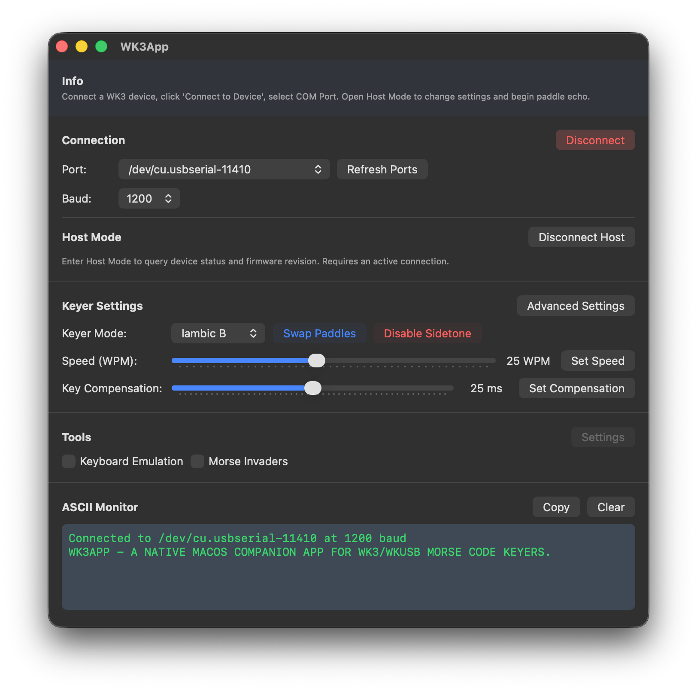

# WK3 Device Interface



A native macOS application for controlling and configuring **WK3/WKUSB Morse code keyer** devices. Built with SwiftUI for a native macOS experience.

## Features

- **Serial communication** with WK3 devices via USB
- **Full WK3 protocol support** — Admin commands, mode registers, PinCFG, WPM, key compensation
- **Keyboard emulation** — paddle input typed as characters in any text field
- **Morse Invaders mode** — converts characters to Morse (Left Ctrl = dit, Right Ctrl = dah) with configurable timing
- **Real-time ASCII monitor** — displays decoded paddle input
- **Keyer settings** — Iambic A/B, Ultimatic, Bug modes, paddle swap, sidetone
- **Advanced register control** — WKMode and PinCFG registers with per-bit toggles
- **Debug panel** — raw hex command input and protocol log
- **Send text window** — send ASCII text directly to the WK3 device

## Requirements

- macOS 13.0 (Ventura) or later
- Xcode 15.0 or later (for building)
- A WK3/WKUSB device connected via USB

### Accessibility Permissions

Keyboard emulation and Morse Invaders mode require **Accessibility** access. On first launch, the app will prompt you to enable this in:

**System Settings > Privacy & Security > Accessibility**

Add WK3App to the allowed list for keyboard emulation to work.

## Building

### Using Xcode (recommended)

1. Clone the repository:
   ```bash
   git clone <repository-url>
   cd WK3App
   ```

2. Open the project in Xcode:
   ```bash
   open WK3App.xcodeproj
   ```

3. Select the **WK3App** scheme and your target device (My Mac).

4. Build and run with **Cmd+R**.

### Using the command line

1. Clone and navigate to the repository:
   ```bash
   git clone <repository-url>
   cd WK3App
   ```

2. Build:
   ```bash
   xcodebuild -project WK3App.xcodeproj -scheme WK3App -destination 'platform=macOS' build
   ```

3. The built app will be at:
   ```
   ~/Library/Developer/Xcode/DerivedData/WK3App-*/Build/Products/Debug/WK3App.app
   ```

## Usage

1. Connect your WK3 device via USB
2. Launch WK3App
3. Select the serial port from the dropdown (auto-populated)
4. Set baud rate to **1200** (default)
5. Click **Connect to Device**
6. Click **Open Host** to enter host mode and configure settings

### Keyboard Emulation

1. Enable **Keyboard Emulation** toggle
2. Use your paddle — characters are typed into the active text field
3. Toggle **CAPS LOCK** to switch between uppercase/lowercase output

### Morse Invaders

1. Enable **Morse Invaders** toggle
2. Adjust timing sliders (key duration, delay between keys, letter spacing)
3. Use your paddle — dit sends Left Ctrl, dah sends Right Ctrl

## Project Structure

```
WK3App/
├── WK3App.xcodeproj/        # Xcode project
├── src/
│   ├── WK3App.swift          # App entry point and menu bar
│   ├── Models/
│   │   ├── AppState.swift    # UI state and register parsing
│   │   ├── MorseCode.swift   # Morse code lookup table
│   │   └── WK3Device.swift   # WK3 protocol and serial commands
│   ├── Services/
│   │   ├── SerialService.swift             # POSIX serial port (termios)
│   │   ├── KeyboardEmulationService.swift  # CGEvent keyboard control
│   │   └── AccessibilityService.swift      # Accessibility permission detection
│   ├── Views/
│   │   ├── ContentView.swift               # Main layout
│   │   ├── ConnectionView.swift            # Port/baud/connect controls
│   │   ├── KeyerSettingsView.swift         # Keyer mode, WPM, compensation
│   │   ├── PinCFGView.swift                # Pin config toggles
│   │   ├── WKModeView.swift                # WKMode register toggles
│   │   ├── ASCIIMonitorView.swift          # ASCII data display
│   │   ├── ToolsView.swift                  # Tools section (emulation, Morse Invaders)
│   │   ├── DebugView.swift                 # Hex commands and log
│   │   ├── SendTextView.swift              # Text send window
│   │   ├── PermissionAlerts.swift          # Accessibility alert
│   │   └── AboutView.swift                 # About window
│   └── Resources/
│       └── Assets.xcassets/                # App icon and accent color
└── LICENSE                  # BSD 2-Clause License
```

## Acknowledgements

WK3App is based on [WK3GUI](https://github.com/joshpeterson1/wk3GUI) by Josh Peterson.

## License

BSD 2-Clause License. See [LICENSE](LICENSE) for details.
